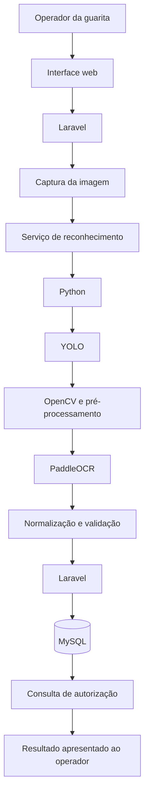
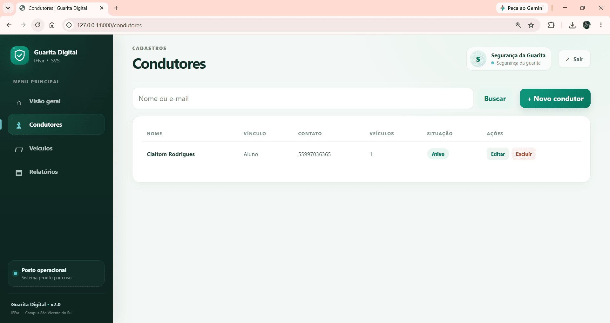
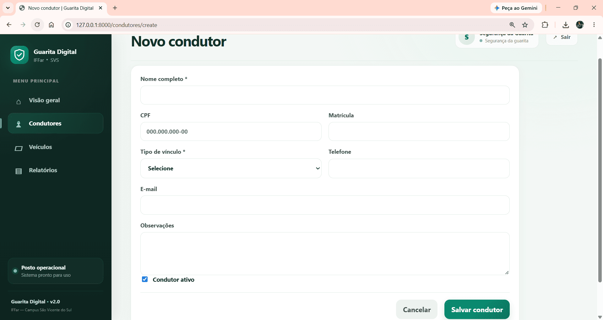
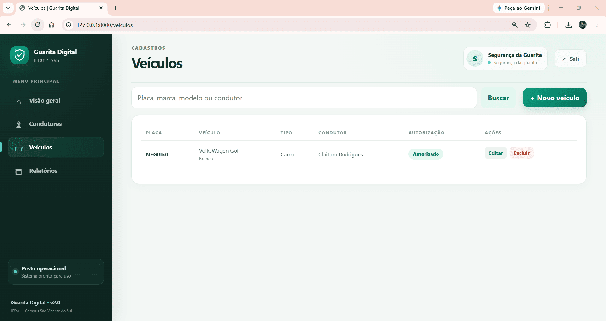
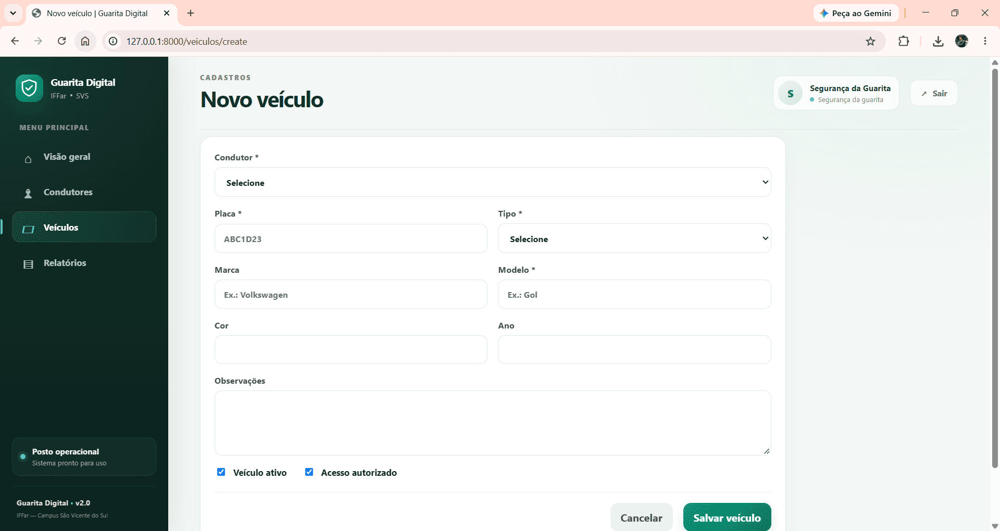
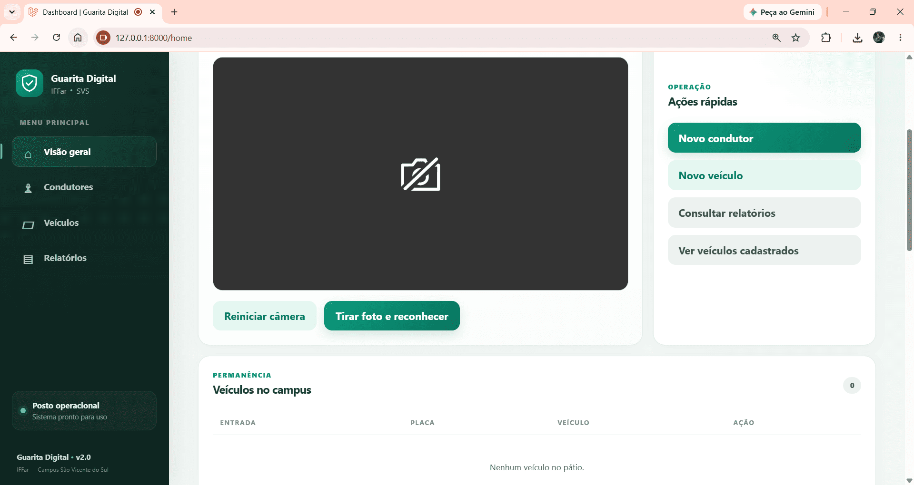
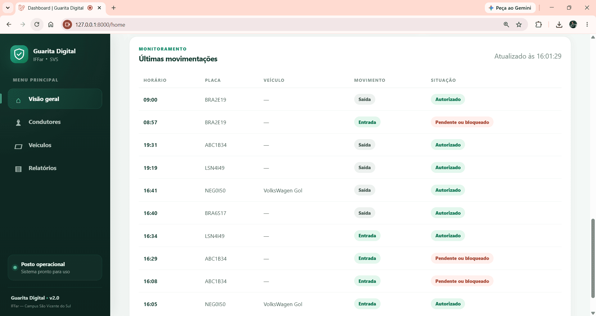
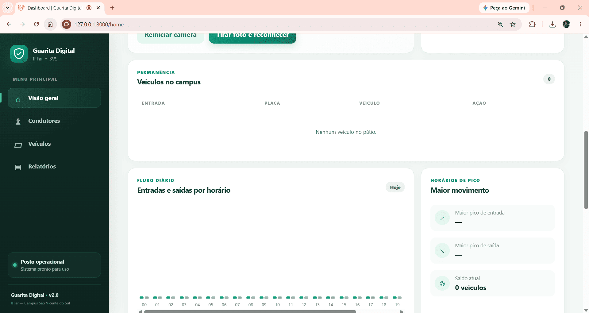
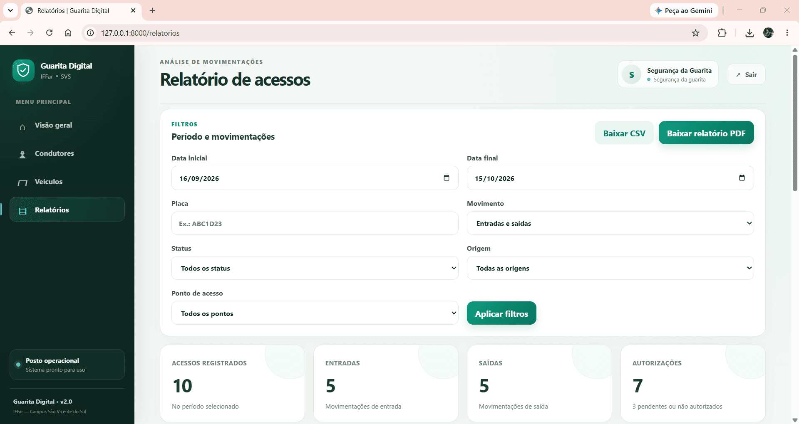
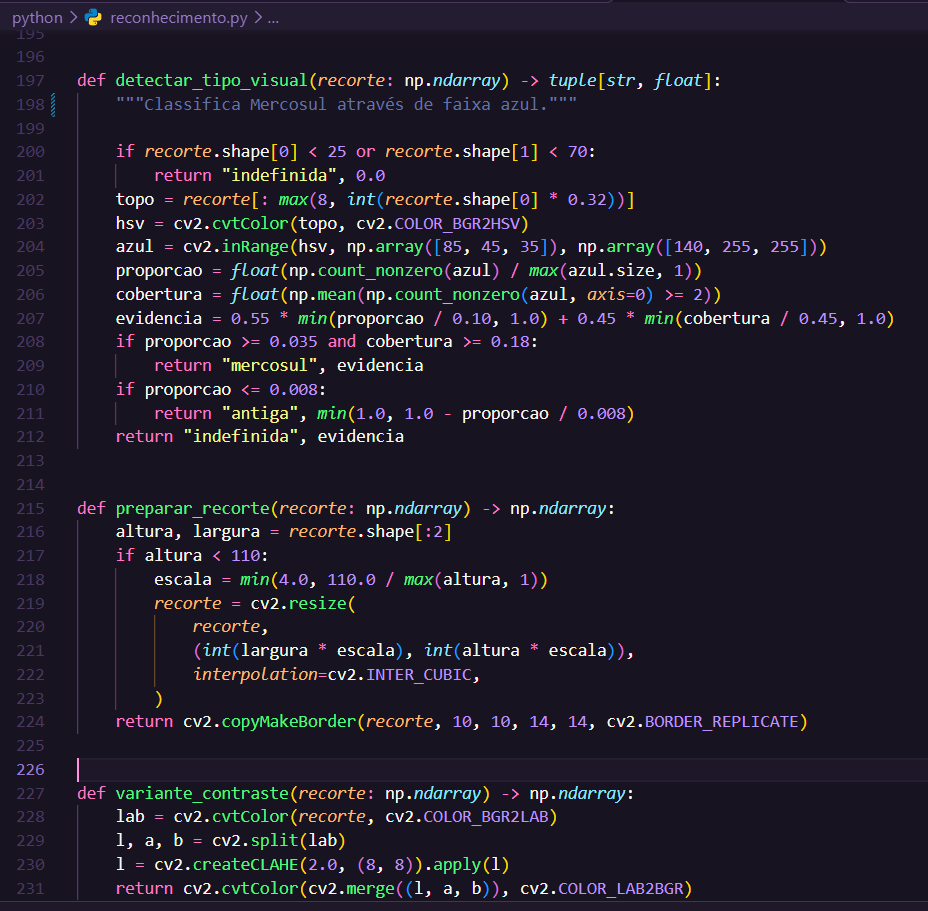

# Guarita Digital

**Sistema Inteligente de Controle de Acesso Veicular**

**Instituto Federal Farroupilha — Campus São Vicente do Sul**

**Trabalho de Conclusão de Curso — Tecnologia em Análise e Desenvolvimento de Sistemas**

---

## 1. Apresentação

O **Guarita Digital** é um sistema web desenvolvido como Trabalho de Conclusão de Curso (TCC), com o objetivo de auxiliar o controle de entrada e saída de veículos em ambientes institucionais.

A solução integra tecnologias de desenvolvimento web, bancos de dados relacionais e visão computacional, permitindo o gerenciamento de condutores, veículos, autorizações de acesso e registros de movimentação.

Seu principal diferencial é a utilização de técnicas de inteligência artificial para o reconhecimento automático de placas veiculares, combinando o modelo **YOLO (You Only Look Once)** para detecção de objetos e o **PaddleOCR** para reconhecimento óptico de caracteres.

O sistema foi desenvolvido utilizando o framework Laravel, com processamento de imagens realizado em Python, proporcionando uma arquitetura modular e organizada.

### Objetivo geral

Desenvolver um sistema informatizado capaz de auxiliar o gerenciamento e monitoramento do acesso de veículos ao Instituto Federal Farroupilha — Campus São Vicente do Sul, integrando reconhecimento automático de placas e consulta a registros cadastrais.

### Objetivos específicos

- Desenvolver uma aplicação web para gerenciamento de condutores e veículos.
- Implementar autenticação para operadores da guarita.
- Integrar técnicas de visão computacional ao sistema.
- Identificar placas veiculares nos padrões brasileiro antigo e Mercosul.
- Consultar automaticamente a situação cadastral e de autorização dos veículos.
- Disponibilizar informações sobre entradas, saídas e permanência.
- Apresentar indicadores e relatórios administrativos.
- Avaliar o funcionamento do protótipo em ambiente de testes.

> **Nota:** o Guarita Digital é um protótipo acadêmico. Sua utilização permanente em ambiente institucional requer validação operacional, avaliação de segurança e autorização da instituição.

---

## 2. Tecnologias utilizadas

O desenvolvimento foi realizado com tecnologias selecionadas de acordo com as necessidades de cada componente.

| Tecnologia | Finalidade |
|---|---|
| PHP 8.3+ | Linguagem utilizada no backend |
| Laravel | Framework para desenvolvimento da aplicação web |
| Blade | Construção das interfaces dinâmicas |
| HTML5 | Estruturação das páginas |
| CSS3 | Estilização e responsividade |
| JavaScript | Interatividade e captura de imagens |
| MySQL | Armazenamento dos dados |
| Python 3.11 | Processamento e reconhecimento de placas |
| YOLO | Detecção da região da placa |
| PaddleOCR | Reconhecimento óptico de caracteres |
| OpenCV | Tratamento e manipulação de imagens |
| NumPy | Operações numéricas sobre imagens |
| CLAHE | Aprimoramento adaptativo do contraste |
| Composer | Gerenciamento das dependências PHP |
| pip | Gerenciamento das dependências Python |
| Laragon | Ambiente de desenvolvimento local |
| Git e GitHub | Versionamento e disponibilização do código |

---

## 3. Arquitetura do sistema

O projeto utiliza uma arquitetura modular, separando as responsabilidades da aplicação web e do processamento de imagens.

O Laravel atua como componente central, gerenciando autenticação, regras de negócio, validações, persistência de dados e comunicação com o módulo Python.

O Python é responsável pelas operações de visão computacional necessárias para identificar a placa presente na imagem capturada.

### 3.1 Fluxo de funcionamento



### 3.2 Integração Laravel e Python

A comunicação entre os componentes é realizada localmente.

Quando o operador captura uma imagem, o navegador encaminha os dados ao Laravel por meio de uma requisição HTTP.

O controller responsável valida a imagem recebida e cria um arquivo temporário no sistema.

Em seguida, o serviço de reconhecimento executa o script Python configurado, fornecendo o caminho do arquivo como argumento.

O Python processa a imagem e devolve uma resposta em formato JSON, contendo a placa identificada ou uma justificativa para a ausência de reconhecimento válido.

O Laravel interpreta o resultado, realiza a consulta ao banco de dados e apresenta as informações correspondentes.

Após o processamento, o arquivo temporário é removido.

Essa organização permite manter as regras de negócio separadas das rotinas de inteligência artificial.

---

## 4. Estrutura do projeto

A organização dos diretórios segue a estrutura convencional do Laravel, com a adição de um módulo específico para reconhecimento de placas.

```text
guarita-digital/
│
├── app/
│   ├── Http/
│   │   └── Controllers/
│   ├── Models/
│   ├── Services/
│   └── Support/
│
├── bootstrap/
│
├── config/
│
├── database/
│   ├── migrations/
│   └── seeders/
│
├── public/
│   ├── img/
│   └── ...
│
├── python/
│   ├── reconhecer_imagem.py
│   ├── reconhecimento.py
│   ├── requirements.txt
│   └── .venv/
│
├── resources/
│   └── views/
│
├── routes/
│
├── storage/
│
├── tests/
│
├── .env.example
├── composer.json
└── README.md
```

### 4.1 Diretório app

Contém os componentes responsáveis pelo funcionamento da aplicação Laravel.

**Controllers:** recebem as requisições HTTP, validam os dados e coordenam as operações.

**Models:** representam as entidades do banco de dados e seus relacionamentos.

**Services:** concentram serviços específicos, como a integração com o reconhecimento de placas.

**Support:** contém classes auxiliares utilizadas para normalização, formatação e validação.

### 4.2 Diretório database

Armazena as migrations e os seeders.

As migrations definem a estrutura das tabelas, enquanto os seeders permitem configurar dados iniciais necessários ao funcionamento da aplicação.

### 4.3 Diretório python

Contém os scripts e as dependências responsáveis pelo processamento de imagens.

O arquivo `reconhecer_imagem.py` atua como ponto de entrada para o reconhecimento solicitado pelo Laravel.

O arquivo `reconhecimento.py` concentra funções relacionadas ao processamento visual e à interpretação de placas.

### 4.4 Diretório resources

Contém os templates Blade utilizados para apresentar as interfaces aos operadores.

### 4.5 Diretório public

Contém os recursos públicos da aplicação, incluindo arquivos CSS, JavaScript e imagens.

As imagens apresentadas nesta documentação estão localizadas em `public/img/`.

---

## 5. Funcionalidades do sistema

O Guarita Digital possui módulos voltados às atividades de cadastro, monitoramento e controle de acesso.

### 5.1 Autenticação

O sistema disponibiliza uma interface de autenticação destinada ao operador da guarita.

O acesso pode ser realizado por matrícula ou endereço de e-mail, mediante fornecimento da senha correspondente.

O mecanismo de autenticação restringe o acesso às funcionalidades administrativas.


**Figura 1 — Interface de autenticação do Guarita Digital.**

A página apresenta uma identidade visual institucional e um formulário centralizado para identificação do operador.

A autenticação permite associar as operações administrativas a uma sessão válida, contribuindo para a organização e proteção do ambiente.

### 5.2 Gerenciamento de condutores

O módulo de condutores permite administrar as informações das pessoas associadas aos veículos cadastrados.



**Figura 2 — Interface de gerenciamento de condutores.**

A interface apresenta uma tabela com informações cadastrais, incluindo nome, vínculo institucional, contato, quantidade de veículos associados e situação do cadastro.

Também disponibiliza mecanismos de pesquisa, edição e exclusão.

Essas funcionalidades permitem centralizar os dados necessários para relacionar os veículos aos seus respectivos responsáveis.

### 5.3 Cadastro de condutores



**Figura 3 — Formulário de cadastro de condutores.**

O formulário permite registrar informações como:

- Nome completo;
- CPF;
- Matrícula institucional;
- Tipo de vínculo;
- Telefone;
- Endereço de e-mail;
- Observações;
- Situação ativa ou inativa.

Os dados são submetidos às validações definidas na aplicação antes do armazenamento.

A identificação do vínculo institucional contribui para organizar os registros conforme a relação do condutor com o campus.

### 5.4 Gerenciamento de veículos



**Figura 4 — Interface de gerenciamento de veículos.**

O módulo permite consultar os veículos registrados no banco de dados.

A listagem apresenta a placa, a identificação do veículo, sua categoria, o condutor associado e a situação de autorização.

A interface disponibiliza pesquisa por placa, marca, modelo ou condutor, além de operações de edição, exclusão e inclusão.

A associação entre condutores e veículos permite consultar o responsável por determinado automóvel durante o processo de identificação.

### 5.5 Cadastro de veículos



**Figura 5 — Formulário de cadastro de veículos.**

O formulário contém campos para identificação e caracterização do automóvel:

- Condutor responsável;
- Placa;
- Tipo de veículo;
- Marca;
- Modelo;
- Cor;
- Ano;
- Observações;
- Situação de atividade;
- Autorização de acesso.

A autorização é tratada como uma informação cadastral específica.

Dessa forma, o reconhecimento de uma placa não implica automaticamente que o veículo esteja autorizado a acessar o campus.

A decisão apresentada ao operador depende da consulta às informações registradas.

### 5.6 Captura e reconhecimento de placas



**Figura 6 — Área de captura de imagens e reconhecimento de placas.**

O painel principal disponibiliza uma área destinada à câmera e comandos para reiniciar a captura ou iniciar o reconhecimento.

O fluxo começa com a obtenção de uma imagem pelo navegador.

Após a captura, o conteúdo é encaminhado ao backend para validação e processamento.

O sistema utiliza o reconhecimento automático como recurso de apoio à identificação, permitindo consultar os dados relacionados à placa encontrada.

A qualidade da imagem influencia diretamente o resultado.

Condições como iluminação inadequada, movimento, baixa resolução, reflexos e obstruções podem comprometer a detecção e a leitura dos caracteres.

### 5.7 Histórico de movimentações



**Figura 7 — Histórico das movimentações registradas.**

O painel apresenta uma relação das últimas movimentações disponíveis.

Entre as informações exibidas estão:

- Horário da movimentação;
- Placa do veículo;
- Identificação do automóvel;
- Tipo de movimento;
- Situação de autorização.

Os registros permitem acompanhar eventos de entrada e saída e consultar ocorrências anteriores.

O histórico também contribui para a análise administrativa das movimentações realizadas.

### 5.8 Monitoramento e horários de pico



**Figura 8 — Monitoramento de permanência e movimentação por horário.**

O dashboard possui recursos para acompanhar veículos presentes no campus e analisar o fluxo de movimentações.

A área de permanência apresenta os veículos considerados presentes de acordo com os registros disponíveis.

O gráfico de fluxo diário organiza entradas e saídas por horário, permitindo identificar períodos de maior movimentação.

Os indicadores de pico têm como finalidade auxiliar a compreensão da demanda operacional da guarita.

Os resultados dependem dos dados efetivamente registrados no sistema.

### 5.9 Relatórios administrativos



**Figura 9 — Interface de geração de relatórios.**

O módulo de relatórios permite consultar movimentações utilizando critérios específicos.

Entre os filtros apresentados estão:

- Data inicial;
- Data final;
- Placa;
- Tipo de movimentação;
- Status;
- Origem;
- Ponto de acesso.

A interface também disponibiliza opções para exportação de informações em CSV e PDF.

Os indicadores resumidos apresentam quantidades de acessos, entradas, saídas e autorizações no período selecionado.

Esses recursos auxiliam na organização dos dados e na elaboração de análises administrativas.

---

## 6. Reconhecimento automático de placas

O reconhecimento de placas é um dos principais componentes técnicos do Guarita Digital.

O processamento combina diferentes técnicas de visão computacional para localizar a placa, preparar a região de interesse e interpretar seus caracteres.

### 6.1 Detecção com YOLO

O YOLO, sigla para *You Only Look Once*, é uma família de modelos utilizados para detecção de objetos em imagens.

No projeto, sua função é localizar a região correspondente à placa veicular.

A detecção produz uma região de interesse que pode ser recortada da imagem original e encaminhada às etapas posteriores.

A utilização de um detector permite concentrar o processamento de OCR na área mais relevante da imagem.

### 6.2 Pré-processamento com OpenCV

Após a detecção, o recorte da placa pode passar por operações de tratamento visual.

Essas operações buscam melhorar as condições de leitura e reduzir dificuldades provocadas por características da imagem.

Entre os procedimentos implementados no código apresentado estão o redimensionamento, a adição de bordas e a criação de variantes de contraste.

O OpenCV fornece as funções necessárias para essas transformações.

### 6.3 Redimensionamento

Imagens com dimensões reduzidas podem apresentar caracteres difíceis de distinguir.

A função `preparar_recorte` verifica a altura da região de interesse e, quando necessário, realiza um redimensionamento utilizando interpolação cúbica.

O código também adiciona bordas por replicação dos pixels periféricos.

Esse procedimento prepara o recorte para as operações seguintes, sem garantir, por si só, a recuperação de detalhes ausentes na imagem original.

### 6.4 CLAHE

O CLAHE, sigla para *Contrast Limited Adaptive Histogram Equalization*, é uma técnica de equalização adaptativa de histograma com limitação de contraste.

Diferentemente de uma equalização global, o CLAHE atua sobre regiões locais da imagem.

Seu objetivo é aprimorar diferenças de luminosidade sem amplificar excessivamente o contraste.

No Guarita Digital, a técnica é aplicada ao canal de luminosidade do espaço de cores LAB.

O processamento segue as seguintes operações:

1. Conversão da imagem de BGR para LAB.
2. Separação dos canais de luminosidade e cor.
3. Aplicação do CLAHE ao canal de luminosidade.
4. Recomposição dos canais.
5. Conversão da imagem para BGR.

A técnica pode contribuir para melhorar a legibilidade de caracteres em determinadas condições de iluminação.

### 6.5 Reconhecimento óptico com PaddleOCR

O PaddleOCR é utilizado para interpretar os caracteres presentes na região da placa.

Após a preparação da imagem, o mecanismo de OCR busca identificar a sequência alfanumérica.

O resultado precisa ser tratado e validado antes de ser utilizado na consulta cadastral.

Isso ocorre porque o reconhecimento óptico pode produzir caracteres incorretos, especialmente em imagens de baixa qualidade.

### 6.6 Padrões de placas brasileiras

O sistema contempla a identificação de placas nos padrões brasileiro antigo e Mercosul.

O padrão antigo utiliza a sequência de três letras e quatro números.

Exemplo:

`ABC1234`

O padrão Mercosul utiliza quatro letras e três números, com uma letra na quinta posição.

Exemplo:

`ABC1D23`

A aplicação utiliza rotinas de normalização e validação para verificar a compatibilidade do resultado com os formatos aceitos.

### 6.7 Classificação visual do padrão

O código também apresenta uma função denominada `detectar_tipo_visual`.

Essa função examina características cromáticas da região superior da placa.

O processamento utiliza o espaço de cores HSV e identifica pixels que se enquadram em uma faixa associada à cor azul.

A partir da proporção e da distribuição desses pixels, a função estima evidências de compatibilidade com o padrão Mercosul.

Quando a evidência é insuficiente, o resultado pode ser classificado como indefinido.

Essa análise constitui um recurso auxiliar e não substitui a validação da sequência alfanumérica reconhecida.

---

## 7. Explicação do código de processamento



**Figura 10 — Implementação de rotinas de processamento de imagens em Python.**

A figura apresenta funções utilizadas no processamento visual das placas.

### 7.1 Função detectar_tipo_visual

```python
def detectar_tipo_visual(recorte: np.ndarray) -> tuple[str, float]:
```

A função recebe uma imagem representada por um array NumPy e retorna uma classificação acompanhada de um valor numérico de evidência.

Inicialmente, verifica se a imagem possui dimensões mínimas para análise.

Em seguida, seleciona a região superior do recorte e realiza a conversão para HSV.

O código utiliza `cv2.inRange` para identificar pixels em uma faixa de tonalidade azul.

Posteriormente, calcula indicadores de proporção e cobertura, utilizados na classificação visual.

Os resultados possíveis incluem:

- `mercosul`;
- `antiga`;
- `indefinida`.

### 7.2 Função preparar_recorte

```python
def preparar_recorte(recorte: np.ndarray) -> np.ndarray:
```

A função recebe o recorte da placa e verifica suas dimensões.

Caso a altura seja inferior ao limite definido, realiza o redimensionamento da imagem.

A interpolação `cv2.INTER_CUBIC` é utilizada para calcular os novos pixels durante o aumento.

Posteriormente, a função `cv2.copyMakeBorder` acrescenta bordas à imagem.

A operação utiliza `cv2.BORDER_REPLICATE`, replicando pixels das extremidades.

### 7.3 Função variante_contraste

```python
def variante_contraste(recorte: np.ndarray) -> np.ndarray:
    lab = cv2.cvtColor(recorte, cv2.COLOR_BGR2LAB)
    l, a, b = cv2.split(lab)
    l = cv2.createCLAHE(2.0, (8, 8)).apply(l)
    return cv2.cvtColor(
        cv2.merge((l, a, b)),
        cv2.COLOR_LAB2BGR
    )
```

A função recebe uma imagem e produz uma variante com contraste local aprimorado.

A conversão para LAB permite separar a luminosidade das informações cromáticas.

O CLAHE é aplicado ao canal `L`, utilizando limite de contraste `2.0` e uma grade de blocos `8 × 8`.

Depois, os canais são reunidos e convertidos novamente para BGR.

Essa implementação permite aprimorar o contraste local sem modificar diretamente os canais cromáticos durante a equalização.

### 7.4 Controller de captura

O arquivo `CapturaCameraController.php` coordena o recebimento e o processamento das imagens enviadas pela interface.

Suas principais responsabilidades são:

1. Validar a presença do campo `image`.
2. Verificar o tamanho máximo permitido.
3. Conferir o formato Base64.
4. Decodificar o conteúdo.
5. Verificar se os bytes representam uma imagem válida.
6. Armazenar a captura temporariamente.
7. Chamar o serviço de reconhecimento.
8. Consultar o cadastro do veículo.
9. Retornar os dados em JSON.
10. Remover o arquivo temporário.

A chamada ao serviço é realizada por meio do método:

```php
$placa = $reconhecimento->reconhecer(
    Storage::disk('local')->path($caminhoTemporario)
);
```

A separação das responsabilidades evita concentrar toda a lógica de reconhecimento no controller.

### 7.5 Serviço de reconhecimento

O arquivo `ReconhecimentoPlacaService.php` centraliza a execução do mecanismo de reconhecimento.

No modo local, utiliza o componente `Process` do Laravel para executar o interpretador Python configurado.

O serviço também é responsável por interpretar a resposta JSON, normalizar a placa e tratar situações em que o reconhecimento não produz um resultado válido.

O modo local é utilizado para a execução do protótipo no ambiente de desenvolvimento.

---

## 8. Banco de dados

O sistema utiliza um banco de dados relacional MySQL.

A persistência dos dados é realizada por meio do Eloquent ORM, disponibilizado pelo Laravel.

### 8.1 Condutores

Representam as pessoas cadastradas e associadas aos veículos.

Os registros incluem dados de identificação, vínculo institucional e contato.

### 8.2 Veículos

Representam os automóveis cadastrados.

Cada veículo pode ser associado a um condutor e possui informações relacionadas à identificação e à autorização de acesso.

### 8.3 Acessos

Representam os registros de movimentação utilizados pelo sistema para consultas, histórico e relatórios.

Esses registros permitem organizar informações de entrada, saída e situação operacional.

### 8.4 Relacionamentos

A aplicação utiliza relacionamentos entre os modelos para recuperar informações associadas.

Por exemplo, uma consulta de veículo pode recuperar os dados do condutor responsável.

Essa estrutura reduz a necessidade de duplicar informações cadastrais e facilita a manutenção dos registros.

---

## 9. Instalação e configuração

### 9.1 Requisitos

Para executar o projeto localmente, são necessários:

- PHP 8.3 ou superior;
- Composer;
- MySQL 8 ou MariaDB compatível;
- Python 3.11 de 64 bits;
- Laragon ou ambiente equivalente;
- Navegador atualizado;
- Permissão de acesso à câmera;
- Conexão com a internet durante a instalação inicial das dependências e modelos.

Os arquivos CSS e JavaScript necessários já estão disponíveis no projeto, não sendo obrigatória a instalação de pacotes NPM para a execução descrita.

### 9.2 Instalar dependências PHP

Abra o terminal na pasta do projeto:

```powershell
cd C:\laragon\www\guarita-digital
composer install
```

### 9.3 Configurar o ambiente

Para uma instalação nova:

```powershell
Copy-Item .env.example .env
php artisan key:generate
```

Em instalações existentes, preserve o arquivo `.env` e a chave `APP_KEY`.

### 9.4 Configurar o MySQL

Exemplo de configuração local:

```dotenv
APP_NAME="Guarita Digital"
APP_ENV=local
APP_DEBUG=true
APP_URL=http://127.0.0.1:8000
APP_TIMEZONE=America/Sao_Paulo

DB_CONNECTION=mysql
DB_HOST=127.0.0.1
DB_PORT=3306
DB_DATABASE=guarita_digital
DB_USERNAME=root
DB_PASSWORD=
```

Os valores devem corresponder ao banco configurado no computador.

Crie o banco de dados antes de executar as migrations.

Para uma instalação nova:

```powershell
php artisan migrate
```

**Atenção:** não execute `migrate:fresh` em um banco que contenha dados que precisam ser preservados.

### 9.5 Criar ambiente virtual Python

```powershell
py -3.11 -m venv python\.venv
```

Atualize o pip:

```powershell
.\python\.venv\Scripts\python.exe -m pip install --upgrade pip
```

Instale as dependências:

```powershell
.\python\.venv\Scripts\python.exe -m pip install -r python\requirements.txt
```

### 9.6 Configurar o reconhecimento local

Adicione ao `.env`:

```dotenv
OCR_MODE=local

PYTHON_PATH="C:/laragon/www/guarita-digital/python/.venv/Scripts/python.exe"

PLACA_SCRIPT="C:/laragon/www/guarita-digital/python/reconhecer_imagem.py"

OCR_TIMEOUT_SECONDS=180
OCR_IDLE_TIMEOUT_SECONDS=90
MAX_CAPTURE_KB=10240
```

Os caminhos devem ser ajustados caso o projeto esteja instalado em outro diretório.

O reconhecimento local não depende de Cloudflare Tunnel nem de uma API externa.

### 9.7 Configurar serviços locais

```dotenv
SESSION_DRIVER=file
CACHE_STORE=file
QUEUE_CONNECTION=sync

LOG_CHANNEL=stack
LOG_LEVEL=debug
```

### 9.8 Limpar configurações e iniciar

```powershell
php artisan optimize:clear
php artisan serve
```

Acesse:

**http://127.0.0.1:8000**

### 9.9 Configuração do operador

O projeto utiliza variáveis para definir a conta operacional inicial:

```dotenv
GUARD_NAME="Operador da Guarita"
ADMIN_EMAIL="operador@exemplo.local"
ADMIN_MATRICULA="operador"
ADMIN_PASSWORD="DEFINIR_SENHA_SEGURA"
```

Esses valores são exemplos e devem ser substituídos antes da criação da conta.

O seeder responsável pela conta operacional pode desativar e mover para exclusão lógica outras contas existentes.

Portanto, execute o seeder apenas quando esse comportamento for desejado.

```powershell
php artisan db:seed --class=UsuariosSistemaSeeder
```

Em atualizações normais de instalações existentes, não é necessário executar novamente o seeder.

---

## 10. Segurança e proteção de dados

O Guarita Digital utiliza mecanismos de autenticação, validação de entradas e controle de acesso às funcionalidades administrativas.

### 10.1 Autenticação

O acesso ao ambiente operacional é restrito a usuários autenticados.

### 10.2 Validação de dados

As informações recebidas pelos formulários e pela captura de imagens são submetidas às validações definidas no backend.

### 10.3 Armazenamento temporário

As imagens utilizadas no reconhecimento são armazenadas temporariamente durante o processamento.

Após a conclusão do fluxo, o arquivo temporário é removido.

### 10.4 Proteção de credenciais

O arquivo `.env` não deve ser publicado no GitHub.

Recomenda-se utilizar um `.gitignore` que contemple:

```gitignore
.env
.env.*
!.env.example

/vendor/
/python/.venv/
/python/__pycache__/
/storage/logs/*.log
```

Também devem ser evitadas publicações de senhas, tokens, chaves privadas e dados pessoais utilizados nos testes.

### 10.5 Ambiente de produção

Em produção, recomenda-se utilizar:

```dotenv
APP_ENV=production
APP_DEBUG=false
```

Além disso, devem ser consideradas políticas institucionais de segurança, permissões, HTTPS, proteção de dados e controle de acesso.

---

## 11. Testes e validação

O protótipo permite a realização de testes funcionais relacionados aos principais módulos.

### 11.1 Testes cadastrais

Verificação de inclusão, consulta, edição e exclusão de condutores e veículos.

### 11.2 Testes de autenticação

Verificação de acesso com credenciais válidas e rejeição de tentativas não autorizadas.

### 11.3 Testes de reconhecimento

Avaliação do processamento de imagens de placas brasileiras nos padrões antigo e Mercosul.

As condições de iluminação, distância, resolução e posicionamento podem influenciar os resultados.

### 11.4 Testes de autorização

Verificação da consulta de veículos cadastrados, autorizados e não autorizados.

### 11.5 Testes de relatórios

Conferência dos filtros, indicadores e arquivos exportados.

### 11.6 Avaliação de desempenho

Uma avaliação quantitativa pode considerar:

- Quantidade de imagens processadas;
- Taxa de detecção correta;
- Taxa de leitura correta;
- Tempo médio de processamento;
- Condições de iluminação;
- Padrão da placa;
- Distância e ângulo de captura.

Os resultados numéricos devem ser apresentados somente após medições documentadas.

---

## 12. Limitações do protótipo

O reconhecimento automático depende da qualidade da imagem recebida.

Entre os fatores que podem afetar o processamento estão:

- Baixa luminosidade;
- Reflexos;
- Movimento;
- Desfoque;
- Obstrução parcial da placa;
- Resolução insuficiente;
- Ângulos de captura desfavoráveis.

A identificação correta da placa também não significa que o veículo esteja automaticamente autorizado.

A autorização é determinada pela consulta aos dados cadastrais.

Por se tratar de um protótipo acadêmico, a implantação definitiva exige validação em campo e adequação à infraestrutura institucional.

---

## 13. Possibilidades de evolução

O projeto poderá ser aprimorado por meio de:

- Ampliação dos testes com imagens reais;
- Aperfeiçoamento do reconhecimento em condições adversas;
- Avaliação sistemática de precisão e desempenho;
- Melhorias na visualização de indicadores;
- Ampliação dos mecanismos de auditoria;
- Integração com equipamentos de controle de acesso;
- Adaptação para ambientes institucionais de produção;
- Otimização dos recursos computacionais utilizados.

Essas possibilidades representam perspectivas futuras, não funcionalidades necessariamente implementadas nesta versão.

---

## 14. Contexto acadêmico

**Projeto:** Guarita Digital

**Natureza:** Trabalho de Conclusão de Curso

**Instituição:** Instituto Federal Farroupilha

**Campus:** São Vicente do Sul

**Curso:** Tecnologia em Análise e Desenvolvimento de Sistemas

**Área de conhecimento:** Desenvolvimento Web, Bancos de Dados e Visão Computacional

O Guarita Digital demonstra a aplicação integrada de conhecimentos de engenharia de software, desenvolvimento web, persistência de dados e inteligência artificial na construção de uma solução voltada a uma necessidade institucional.

O projeto busca contribuir para a informatização e organização do processo de controle de acesso veicular, utilizando técnicas de reconhecimento automático de placas como apoio às atividades dos operadores.

---

## 15. Considerações finais

O desenvolvimento do Guarita Digital representa a integração entre tecnologias web e técnicas de visão computacional em uma aplicação voltada ao controle de acesso de veículos.

A utilização do Laravel proporciona uma estrutura organizada para gerenciamento cadastral, autenticação e consultas, enquanto o Python oferece os recursos necessários para processamento de imagens e reconhecimento de placas.

A combinação entre YOLO, PaddleOCR e OpenCV permite explorar diferentes etapas do reconhecimento automático, desde a localização da região da placa até a interpretação dos caracteres.

Os módulos de cadastro, monitoramento e relatórios complementam a solução, oferecendo recursos administrativos para consulta e acompanhamento das movimentações.

Dessa forma, o projeto constitui um protótipo acadêmico que demonstra a viabilidade técnica de integrar desenvolvimento web, bancos de dados e visão computacional, estabelecendo uma base para avaliações práticas e futuras melhorias.

---

## Documentação visual

As imagens utilizadas nesta documentação estão localizadas no diretório:

```text
public/img/
```

Arquivos referenciados:

```text
login.png
condutores.png
cadastrarCondutor(1).png
veiculos.png
cadastrarVeiculo(1).png
reconhecer.png
histórico.png
grafico.png
relatorios.png
codigo.png
```

Os nomes dos arquivos devem corresponder exatamente aos existentes no repositório.

---

**Guarita Digital — Trabalho de Conclusão de Curso**

**Instituto Federal Farroupilha — Campus São Vicente do Sul**
